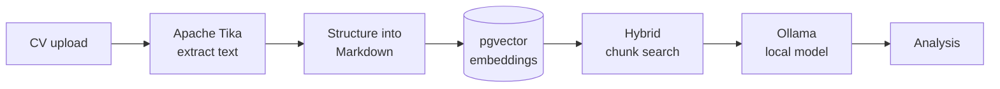

# local-ai

**Your CV stays on your machine.** local-ai reads a CV, structures it and searches it with a
language model that runs on your own computer. No document goes to a cloud API.


> [!WARNING]
> **Work in progress.** The pipeline below is built piece by piece, but the CV analysis does
> not work end to end yet: it needs tuning and bug fixes.

## How it works



Two modules share the pipeline: `cv` for CVs and `job` for job ads. The prompts live in
`src/main/resources/prompts`.

## Run it locally

You need Docker, JDK 17 and Node.js.

```bash
cp .env.example .env                    # fill in the values
docker compose up -d postgres ollama    # pgvector on 5432, Ollama on 11434
docker compose exec ollama ollama pull gemma2:2b
docker compose exec ollama ollama pull nomic-embed-text
./mvnw spring-boot:run                  # API on http://localhost:8080
```

In a second terminal:

```bash
cd frontend
npm install
npm run dev                             # Vite prints the local URL
```

Prefer containers all the way? `docker compose up` starts the backend too. Swap models with
`OLLAMA_MODEL` and `OLLAMA_EMBEDDING_MODEL`.

## Stack

| Layer | |
|---|---|
| Backend | Java 17, Spring Boot 4, Spring AI 2.0 (milestone), Spring Security, JPA, ArchUnit |
| Models | Ollama: `gemma2:2b` for chat, `nomic-embed-text` for embeddings |
| Data | PostgreSQL 16 with pgvector |
| Documents | Apache Tika 3.2 |
| Frontend | React 19, TypeScript, Vite, Tailwind |

## Under the hood

The roadmap, the task board and the design decisions are in [`docs/ai/`](docs/ai/).
